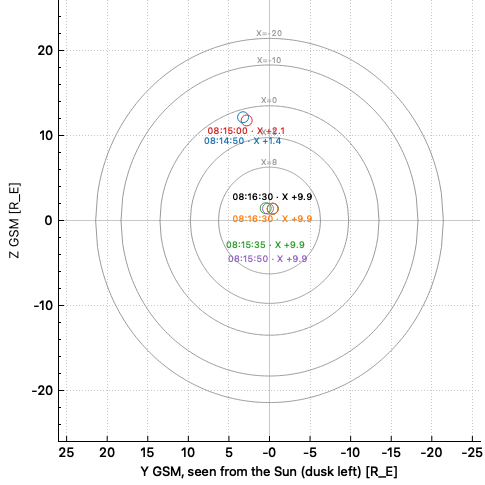

# sciqlop-tracers-mp

A [SciQLop](https://github.com/SciQLop/SciQLop) plugin that answers one question for the
TRACERS spacecraft (NASA SMEX, TRACERS-1 and TRACERS-2): **at this time, where does the magnetic field
line through the spacecraft meet the magnetopause?**

You drag a time bar across your plot panel. A dock beside the panel shows the magnetopause seen from the
Sun, with the point where the field line meets it. You can pin points to keep them.



*TRACERS-2, 2025-09-30. Lobe lines (08:14:50, 08:15:00) graze the high-latitude boundary near X ≈ 1–2 R_E.
Closed lines (08:15:35 onward) graze it near the nose, X ≈ 9.9 R_E. Hollow markers mean the field line comes
close to the magnetopause without crossing it (see [Topology](#topology-and-the-plotted-point)).*

---

## Install

In a SciQLop workspace, install the package with SciQLop's package installer, so it is recorded in the
workspace manifest:

```
sciqlop-tracers-mp @ git+https://github.com/nicolasaunai/sciqlop-tracers-mp
```

Restart SciQLop. The plugin registers through the `sciqlop.plugins` entry point. It needs `numpy`, `scipy`,
`speasy` and `geopack` (installed automatically) and network access to SSCWeb and CDAWeb.

## Use

1. In a plot panel, click **MP ▾** in the panel header and choose **TRACERS-1** or **TRACERS-2**. The
   satellite whose products are on the panel is listed first.
2. A black vertical bar appears across **all** plots of the panel, and a dock opens beside the panel.
3. Drag the bar. About 0.25 s after it stops, the field line at that time is traced (1–4 s). The dock shows:
   - the status line: field-line topology and the magnetopause point in GSM;
   - the spacecraft position in GSM, magnetic latitude (SM) and MLT;
   - the solar-wind inputs used, in orange with ⚠ when outside the T96 range (details in the tooltip);
   - the map: the T96 magnetopause seen from the Sun, cross-sections at X = 8, 5, 0, −10, −20 R_E, and the
     current point (black) labelled `HH:MM:SS · X`.
4. **Pin** keeps the current point in its own colour, with a table row (time, topology, X, Y, Z). The row
   tooltip lists everything about it. **×** removes a pin; **Clear** removes them all.
5. Closing the dock removes the bar. Closing the panel closes the dock.

A time already computed (to the second) is shown immediately from a cache.

---

## Assumptions

Every choice below affects the point drawn on the map. They are listed so you can judge whether the
result fits your use.

### Spacecraft position

- **Source: SSCWeb** (`ssc/tracers1`, `ssc/tracers2` through speasy), in **GEO**, 60 s sampling.
- **Interpolation: cubic spline** over a ±10 min window. Checked against the 1 s `TS2_L2_MAG_BDC-16SPS`
  GEO position on 2025-09-30 08:10–08:19: within **0.4 km** (linear interpolation would be 4 km).
- **GEO → GSM** with geopack (`recalc` at the time, then `geogsm`). Agrees with spacepy to < 2 km.
- **Why not the TRACERS MAG position?** There is no TS1 MAG dataset on CDAWeb. In addition,
  `ts2_l2_mag_1sps_gei2000_pos` and `_vel` (TS2 L2 MAG) are rotated by about **−51° about Z** relative to the
  true GEI frame (checked 2025-09-30 08:14–08:17). The evidence: IGRF at the GEO position is within 0.3° of
  the measured `ts2_l2_mag_16sps_gei2000_b`; IGRF at the `gei2000_pos` position is 12.6° off.
  `ts2_l2_mag_1sps_geo_pos` is consistent with SSCWeb to 0.4 km. **Do not use the MAG GEI position or
  velocity** until this is clarified with the instrument team.

### Solar-wind and geomagnetic inputs

- **Source: `OMNI_HRO_1MIN`** (CDAWeb), already time-shifted to the bow-shock nose. No extra propagation
  delay to the magnetopause is added.
- **Parameters:** `Pressure` → Pdyn, `SYM_H` → used **in place of Dst**, `BY_GSM`, `BZ_GSM`.
- **At time t:** linear interpolation over valid samples (fill values removed). **No time averaging.** If
  there is no valid sample within **30 min** of t, the computation stops with an error.
- **Range check:** T96 was fitted for Pdyn 0.5–10 nPa, Dst −100 to +20 nT, |By|, |Bz| ≤ 10 nT. Inputs outside
  this range are **used as they are (not clipped)** and flagged ⚠. The model then extrapolates. During storms
  (e.g. 2025-09-30, SYM-H −122 nT, Bz +11 nT) this flag is on.

### Magnetic field model

- **Internal field: IGRF-14** (geopack). After 2025.0 the 2025 main field plus the 2025–2030 secular
  variation is used.
- **External field: T96** (Tsyganenko 1995; Tsyganenko & Stern 1996) through the Python
  [geopack](https://github.com/tsssss/geopack). The dipole tilt comes from `recalc(t)` with the default solar
  wind velocity (−400, 0, 0) km/s GSE, so GSW = GSM.
- **Only T96.** T01, TS04, TS05 and T89 are not offered.
- **No reconnection.** T96 has no X-line. Outside the magnetopause its field is a partial penetration of
  the IMF. The open/closed topology it gives at high latitude is a model property, not an observation.

### Field-line tracing

- From the spacecraft **away from the Earth**: antiparallel to B in the northern hemisphere (geopack
  `dir = +1`), parallel in the southern one (`dir = −1`), chosen from the sign of Z_GSM.
- Stops at **r = 60 R_E**, at geopack's own limits (X ≥ 20 R_E, √(Y²+Z²) ≥ 40 R_E), back at r = 1 R_E, or after
  4000 steps. Geopack's default step control (error 0.001) is used.

### Magnetopause

- **The T96 magnetopause** (geopack `t96_mgnp`, pressure given directly). This is the boundary the T96
  field is built with. It is not Shue et al. (1998) or another empirical model.
- With the pressure given directly, the boundary is **axisymmetric about X_GSM** (no aberration, no
  dipole-tilt dependence). For Pdyn = 4.08 nPa its nose is at 10.03 R_E.
- **Cross-sections:** circles at X = 8, 5, 0, −10, −20 R_E, drawn for **Pdyn at the live time**. They are
  redrawn when Pdyn changes by more than 1 %. A cross-section sunward of the nose is not drawn.

### Topology and the plotted point

Along the traced line, the signed distance to the T96 magnetopause (`t96_mgnp`: positive inside) is
evaluated at every step.

| topology | meaning | point drawn | marker |
|---|---|---|---|
| **open** | the line leaves the magnetopause | crossing point: linear root of the distance between the two bracketing steps, projected onto the boundary | filled |
| **tail** | stays inside up to the outer limit (lobe / tail line) | closest-approach point | hollow |
| **closed** | returns to the Earth without leaving | closest-approach point | hollow |
| **unresolved** | step limit reached first | closest-approach point | hollow |

- The **closest-approach point** is the boundary point that `t96_mgnp` associates with the line point of
  smallest distance. `t96_mgnp` projects along its ellipsoidal coordinate, which tends to the true nearest
  point as the distance goes to zero. The distance is shown ("0.28 R_E inside").
- Why it is shown at all: with T96, cusp-region lines are usually lobe or closed lines that graze the
  boundary without crossing it. Showing crossings only would leave the map empty for most passes.
- **The point is a geometric mapping, not a reconnection site.**

### Map display

- **Seen from the Sun:** horizontal axis = −Y_GSM, ticks relabelled with Y, so **dusk (+Y) is on the left**.
  Vertical axis = Z_GSM. Fixed ±26 R_E on both axes, kept square.
- A Y–Z view hides X, so every point is **labelled with its X**.
- Each pin keeps the point computed with **its own Pdyn**, but the circles are drawn for the live Pdyn. If
  Pdyn changed a lot between pins, a pinned point can sit slightly off the drawn circle.

### Time and caching

- Times are rounded to **1 s**. Results are cached per satellite, 512 entries, for the dock's lifetime.
- Pins are **not saved** when the dock is closed.

---

## Known limitations

- TRACERS only (SSCWeb ids `tracers1`, `tracers2`). Only T96.
- **geopack keeps global state** (`recalc`). The plugin serialises its own geopack calls with a lock, but
  geopack code run at the same time from a notebook in the same kernel does not take it. Avoid tracing in a
  notebook while the map is computing.
- The plugin uses a few **private SciQLop/SciQLopPlots interfaces**, each confined to one module. A SciQLop
  update may break them:
  - `ui/bar.py`: SciQLopPlots `MultiPlotsVerticalLine` on the panel's internal widget;
  - `ui/dock.py`: the main window's QtAds dock manager;
  - `ui/attach.py`: the panel header row (`PanelContainer.chrome_row`) and the `sqp_product_path` property;
  - `ui/viewer.py`: marker shape and size on graph components.
- SciQLopPlots quirks worked around in `ui/viewer.py`: XY axes cannot be reversed (hence −Y with
  relabelled ticks); line graphs draw y(x) only (circles drawn as two halves); `Text` needs an explicit
  coordinate system.
- Built and tested with SciQLop 0.14, geopack 1.0.13, speasy 1.9.1, Python 3.14.

---

## Code layout

```
sciqlop_tracers_mp/
  model.py          Drivers, MapResult, Pin, errors (Qt-free)
  core/             Qt-free physics, testable without SciQLop
    position.py     SSCWeb GEO position, cubic spline
    drivers.py      OMNI inputs, T96 range check
    magnetopause.py T96 boundary: signed distance, radius vs X, cross-sections, nose
    mapping.py      GEO→GSM, MLat/MLT, tracing, topology, Mapper (cache)
    geopack_lock.py lock around geopack's global state
  ui/
    attach.py       "MP ▾" button in each panel header
    bar.py          the bar across all plots
    controller.py   bar → debounce → worker thread → dock; pins
    dock.py         dock beside the panel
    viewer.py       the magnetopause map
    widget.py       status lines, map, Pin/Clear, pin table
    format.py       texts (Qt-free)
  plugin.py         SciQLop entry point
```

Design notes and edge cases: [`docs/design.md`](docs/design.md).

## Tests

```
python -m pytest -q
```

31 offline tests, using saved SSCWeb and OMNI data for 2025-09-30:

- the core never imports Qt;
- the magnetopause geometry (points on the boundary, axisymmetry, nose distance);
- the position and inputs (interpolation, gaps, range flags);
- the mapping (lobe line at 08:14, closed line at 08:16, transition between 08:15:20 and 08:15:30 UT);
- GEO→GSM against spacepy;
- texts, the dock lifecycle and the pin table.

## References

- Tsyganenko, N. A. (1995), Modeling the Earth's magnetospheric magnetic field confined within a realistic
  magnetopause, *J. Geophys. Res.*, 100(A4), 5599–5612.
- Tsyganenko, N. A., & Stern, D. P. (1996), Modeling the global magnetic field of the large-scale Birkeland
  current systems, *J. Geophys. Res.*, 101(A12), 27187–27198.
- King, J. H., & Papitashvili, N. E. (2005), Solar wind spatial scales in and comparisons of hourly Wind and
  ACE plasma and magnetic field data, *J. Geophys. Res.*, 110, A02104 (OMNI).
- IGRF-14, IAGA Division V Working Group V-MOD.

## License

MIT. Author: Nicolas Aunai (LPP, CNRS).
